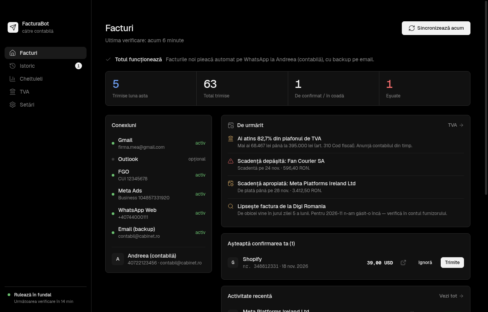
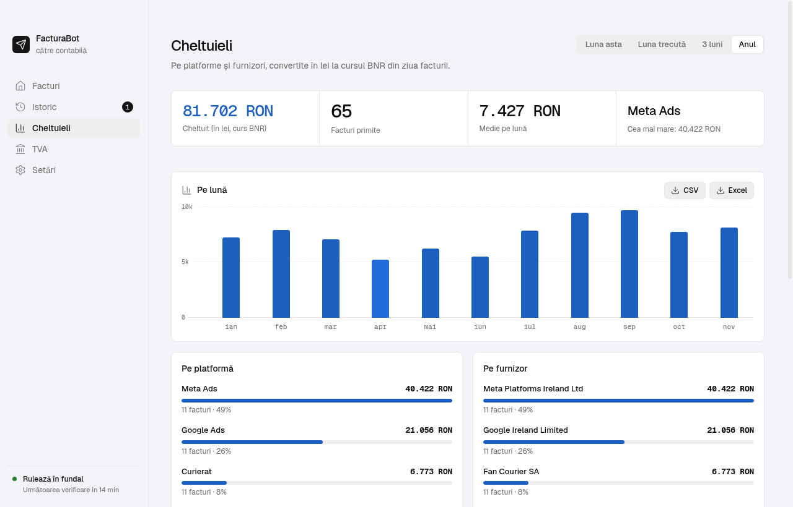
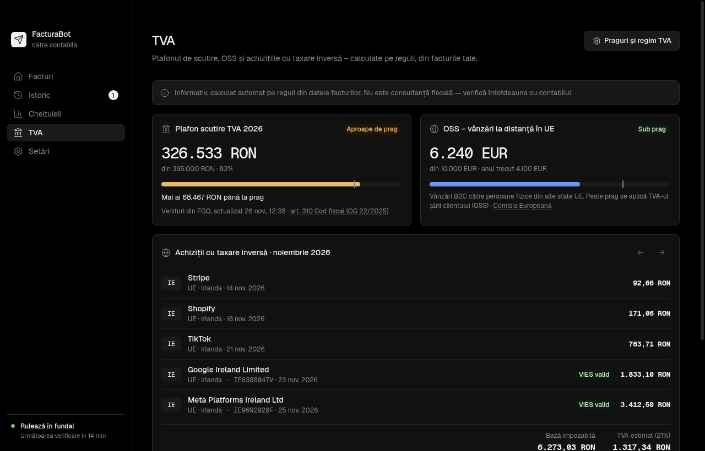
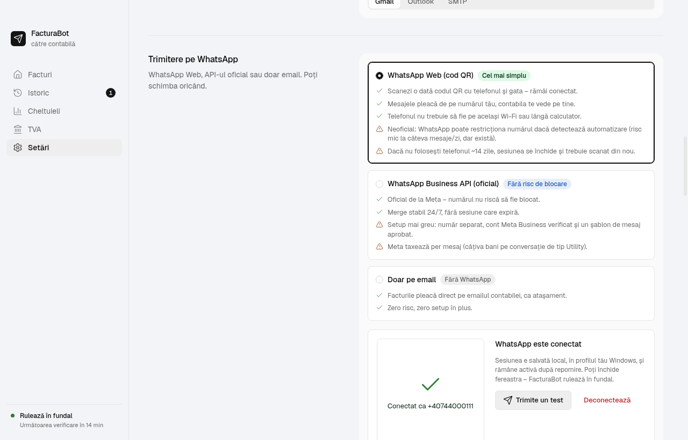
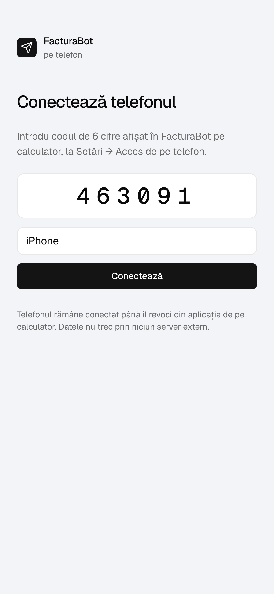
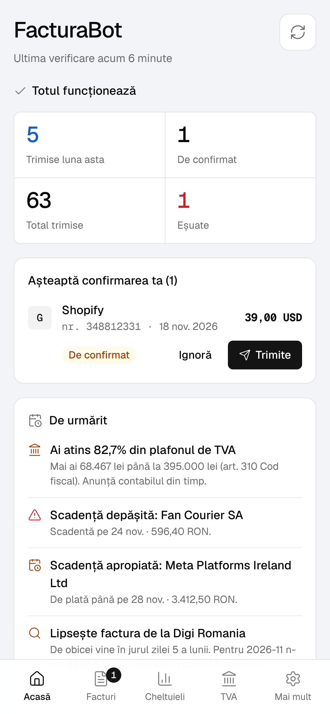
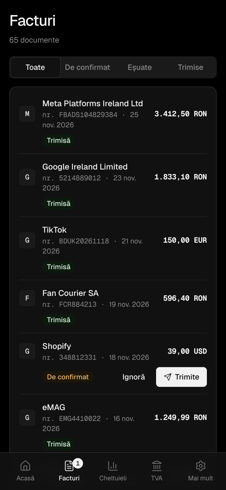
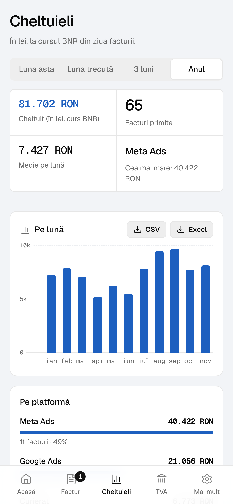
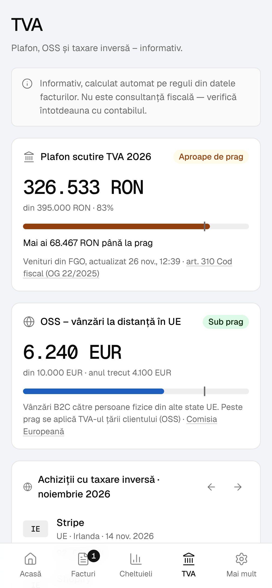
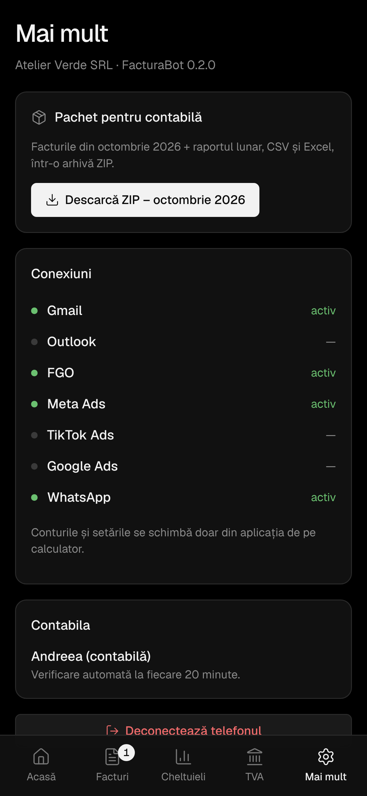

# FacturaBot

**🇷🇴 Facturile ajung singure la contabilă.** FacturaBot este o aplicație Windows care stă discret lângă ceas (în tray), găsește facturile care îți intră pe email (Gmail / Outlook), în FGO și (opțional) direct din Meta Ads, TikTok Ads și Google Ads, și le trimite automat contabilei pe **WhatsApp** sau pe **email**. Din v0.2 îți arată și **cât ai cheltuit** (în lei, la cursul BNR), **ce facturi au TVA cu taxare inversă**, **cât mai ai până la plafonul de TVA** și se poate verifica **de pe telefon**.

Detectarea facturilor este **fără AI, 100% local, pe reguli** (cuvinte cheie, liste de expeditori, nume de fișier și text extras din PDF). Nu e nevoie de nicio cheie API de model.

**🇬🇧 Invoices that deliver themselves to your accountant.** FacturaBot is a Windows tray app that finds incoming invoices in Gmail / Outlook / FGO and (optionally) straight from Meta Ads, TikTok Ads and Google Ads, and forwards them automatically to your accountant via **WhatsApp** or **email**. Since v0.2 it also shows **spending analytics** (in RON at BNR rates), **reverse-charge VAT**, a **VAT-threshold tracker**, and a **phone dashboard**.

Invoice detection is **rule-based, fully local, with no AI** (keywords, sender lists, filename and PDF-text heuristics). No model API key is required.



| Cheltuieli | TVA | Istoric | Setări |
|---|---|---|---|
|  |  |  |  |

**Pe telefon / On the phone** (390×844):

| Conectare | Acasă | Facturi | Cheltuieli | TVA | Mai mult |
|---|---|---|---|---|---|
|  |  |  |  |  |  |

---

## 🇷🇴 Română

### Ce face
- **Surse:** Gmail / Google Workspace, Outlook / Microsoft 365, FGO (facturi de la furnizori + facturile emise de tine). Detectează PDF-urile cu „factură / invoice / receipt / chitanță” și furnizorii cunoscuți: Meta (Facebook/Instagram Ads), Google, TikTok, Shopify, Stripe, PayPal, eMAG, curieri (Fan Courier, Sameday, Cargus, DPD, GLS), utilități, telecom etc. Chitanțele trimise doar în corpul emailului (Meta, PayPal) sunt transformate automat în PDF.
- **Trimitere**, la alegere:
  1. **WhatsApp Web prin cod QR.** Scanezi o singură dată, iar sesiunea rămâne salvată pe PC. *Neoficial:* WhatsApp poate restricționa numărul dacă detectează automatizare. Riscul e mic la câteva mesaje pe zi, iar FacturaBot face pauze între mesaje, dar riscul există.
  2. **WhatsApp Business Cloud API (oficial, Meta).** Nu există risc de blocare, dar ai nevoie de un număr separat, un cont Meta Business și un șablon aprobat.
  3. **Doar email.**
  
  **Backup:** dacă WhatsApp nu merge (de exemplu s-a deconectat), factura pleacă automat pe emailul contabilei, prin Gmail, Outlook sau SMTP.
- **Fără dubluri:** deduplicare după ID-ul mesajului, conținutul fișierului (SHA-256) și seria/numărul facturii de la același furnizor.
- **Rulează în fundal:** pornește odată cu Windows, verifică la fiecare 15–30 de minute (configurabil), are butonul „Sincronizează acum”, notificări, istoric, opțiunea „Confirm înainte de trimitere” și temă luminoasă sau întunecată.
- **Securitate:** tokenurile și parolele sunt criptate cu Windows DPAPI (`safeStorage`), iar totul rămâne pe calculatorul tău. Nu există niciun server intermediar.

### Nou în v0.2
- **De pe telefon.** Activezi în **Setări → Acces de pe telefon**: pornește un mic server local (implicit portul 8787) cu un panou adaptat pentru telefon. Scanezi codul QR sau introduci codul de 6 cifre afișat pe calculator. Pe telefon vezi facturile, cheltuielile și TVA-ul, poți apăsa **Trimite** sau **Ignoră** la facturile care așteaptă confirmarea și poți porni o sincronizare. Se poate instala ca aplicație (PWA, „Adaugă pe ecranul principal”). Nu există niciun server în cloud: datele rămân pe PC.
  - *Securitate:* codul e valabil 10 minute, o singură dată; după 5 coduri greșite se anulează; maxim 10 încercări / 10 min de la aceeași adresă. Telefonul primește un cookie `HttpOnly`, `SameSite=Strict`; pe PC se păstrează doar amprenta lui (SHA-256). Dispozitivele se pot revoca oricând. Cererile care modifică ceva cer antetul `X-FacturaBot`.
  - *Din afara casei:* **Tailscale** (recomandat) – instalezi Tailscale pe PC și pe telefon, apoi rulezi `tailscale serve --bg 8787`; primești o adresă HTTPS privată, pe care o pui la „Adresă publică”. Sau **Cloudflare Tunnel** – `cloudflared tunnel --url http://localhost:8787`; adresa e publică, deci protejeaz-o cu **Cloudflare Access** (codul de împerechere rămâne obligatoriu). Instalarea completă ca PWA (service worker) cere HTTPS, adică una dintre variantele de mai sus; în rețeaua locală panoul merge normal în browser.
- **Facturi direct de la platformele de reclame (opțional).** În **Setări → Platforme de reclame** fiecare sursă are pașii de configurare și butonul **Testează conexiunea**:
  - **Meta Ads** – Marketing API `GET /{business_id}/business_invoices` (Graph v27.0), token de System User cu `business_management` și rol Finance în Billing. Doar pentru facturare lunară; chitanțele de card vin oricum pe email.
  - **TikTok Ads** – API for Business v1.3, `GET /bc/invoice/get/` + `/bc/invoice/download/`, cu Access Token și Business Center ID.
  - **Google Ads** – API v26, `customers/{id}/invoices` (InvoiceService) + PDF; ai nevoie de un developer token, Customer ID, Billing setup ID și apeși **Conectează Google Ads** (scope `adwords`, folosește același client OAuth Google, cu Google Ads API activat în proiect).
  - **Shopify, Stripe, PayPal, eMAG etc.** sunt preluate din email; sumele și TVA-ul se extrag pe reguli din PDF/textul emailului (fără AI).
- **Cheltuieli.** Total pe lună, pe platformă și pe furnizor, convertite în lei la **cursul BNR** (ultimul curs publicat înainte de data facturii, conform art. 290 Cod fiscal – configurabil). Export **CSV** sau **Excel**.
- **TVA (informativ – verifică întotdeauna cu contabila):**
  - detectează achizițiile cu **taxare inversă** (furnizori din UE / din afara UE) și verifică codul de TVA în **VIES**;
  - îți amintește de **D390** (VIES), **D301** (decont special), **D300** și **D700**, în funcție de regimul firmei;
  - **plafonul de scutire** de 395.000 lei (venituri din FGO + venituri introduse manual), cu alertă la 80% (configurabil) și la depășire;
  - **plafonul OSS** de 10.000 EUR pentru vânzări la distanță în UE;
  - **raport lunar PDF** + pachet **ZIP** pentru contabilă (facturi, CSV, Excel, raport), trimis automat într-o zi aleasă sau la cerere.
- **Extra:** facturi lipsă (un furnizor care factura lunar nu a mai trimis), remindere de scadență, interfață care se adaptează și pe ferestre înguste.

### Surse oficiale pentru praguri
| Valoare | Implicit | Sursă |
|---|---|---|
| Plafon scutire TVA | 395.000 lei | art. 310 alin. (1) Cod fiscal, modificat prin [OG 22/2025](https://static.anaf.ro/static/10/Anaf/legislatie/OG_22_2025.pdf) (din 1.09.2025); înregistrarea se cere cel târziu la data depășirii (art. 310 alin. (6)) |
| Cota standard TVA | 21% | [Legea 141/2025](https://legislatie.just.ro/Public/DetaliiDocumentAfis/300022) (din 1.08.2025) |
| Prag OSS | 10.000 EUR / an | art. 59c Directiva 2006/112/CE – [Comisia Europeană, OSS](https://vat-one-stop-shop.ec.europa.eu/one-stop-shop_en) |
| Curs valutar | ultimul curs BNR înainte de data facturii | art. 290 Cod fiscal; cursuri din <https://curs.bnr.ro/files/xml/years/nbrfxrates{an}.xml> |
| Validare cod TVA | VIES | [VIES REST API](https://ec.europa.eu/taxation_customs/vies/#/technical-information) – `POST /check-vat-number` |

Toate pragurile, cota, procentul de alertă și regula de curs se pot modifica în **Setări → Firmă și TVA**, cu linkul sursei afișat lângă fiecare valoare.

### Instalare (utilizator)
1. Rulează `FacturaBot-Setup-x.y.z.exe`. Instalarea se face pentru utilizatorul curent și nu cere drepturi de administrator.
2. Asistentul are 4 pași: **conectezi emailul**, adaugi FGO (opțional), completezi **datele contabilei** și alegi **cum trimiți**.
3. Gata. Poți închide fereastra, iar aplicația rămâne în tray.

> Dacă instalatorul nu are cheile OAuth incluse, le creezi o singură dată, în aproximativ 5 minute (vezi mai jos), și le lipești în **Setări → Surse → Arată cheile aplicației**.

### Credențiale Google (Gmail)
1. Intră pe <https://console.cloud.google.com/> și creează un proiect, de exemplu „FacturaBot”.
2. Mergi la **APIs & Services → Library**, caută **Gmail API** și apasă **Enable**.
3. În **APIs & Services → OAuth consent screen** (sau **Google Auth Platform**):
   - alege User type **External** (sau **Internal** dacă ai Google Workspace);
   - completează numele aplicației și emailul;
   - la **Data access / Scopes** adaugă `gmail.readonly` și `gmail.send`;
   - la **Audience / Test users** adaugă adresa ta de Gmail.
   - ⚠️ Cât timp aplicația e în modul *Testing*, Google expiră autorizarea după 7 zile. FacturaBot îți arată atunci mesajul „Reconectează Gmail”. Ca să nu mai expire, apasă **Publish app** (aplicațiile pentru uz propriu pot rămâne neverificate) sau folosește un cont Workspace cu tipul *Internal*.
4. Mergi la **Credentials → Create credentials → OAuth client ID** și alege tipul **Desktop app**.
5. Copiază **Client ID** și **Client secret** în FacturaBot (**Setări → Surse de facturi → Arată cheile aplicației**), apoi apasă **Conectează** la Gmail. Se deschide browserul, te loghezi și ai terminat.

### Credențiale Microsoft (Outlook / Microsoft 365)
1. Intră pe <https://entra.microsoft.com/> și deschide **App registrations → New registration**.
2. Completează numele „FacturaBot” și alege la Supported account types **Accounts in any organizational directory and personal Microsoft accounts**.
3. La **Redirect URI** alege platforma **Public client/native (mobile & desktop)** și valoarea `http://localhost`.
4. În **Authentication**, setează **Allow public client flows** pe **Yes**.
5. În **API permissions → Microsoft Graph → Delegated** adaugă `Mail.Read`, `Mail.Send`, `User.Read` și `offline_access`.
6. Copiază **Application (client) ID** în FacturaBot. Pentru Outlook nu ai nevoie de client secret.

### FGO
Folosim **cheia API v2**, cu prefixul `fgo_api_v2…`. O creezi în FGO la **eCommerce → API** (nu mai e la Setări → Utilizatori). Ai nevoie și de CUI-ul firmei, fără „RO”, pe care îl trimit ca antet `Fgo-Cod-Unic`.

În aplicație, butonul **Testează conexiunea** apelează `GET /v2/identitate` (nu cere un drept funcțional) și verifică dacă cheia are `furnizori:citire` și, dacă ai bifat facturile emise, `facturi:citire`. Documentația oficială: [autentificare](https://api.fgo.ro/docs/ghiduri/autentificare) și [API v2](https://api.fgo.ro/docs/). FacturaBot folosește `GET /v2/facturi-furnizori`, `GET /v2/facturi` și `POST /v2/facturi/{serie}/{numar}/genereaza-link-de-descarcare`, cu paginare prin cursor, pauză de 1 s între operații și erori `application/problem+json`.

### WhatsApp Business Cloud API (varianta oficială)
1. Intră pe <https://developers.facebook.com/>, creează o aplicație de tip **Business** și adaugă produsul **WhatsApp**.
2. Adaugă și verifică un **număr de telefon separat**. Copiază **Phone number ID**.
3. Creează un **System User** în Business Settings și generează un **token permanent** cu permisiunile `whatsapp_business_messaging` și `whatsapp_business_management`.
4. Creează un **șablon de mesaj** cu următoarele setări și așteaptă aprobarea:
   - categoria **Utility**;
   - numele `factura_noua`;
   - limba `ro`;
   - **Header: Document**;
   - **Body:** `Bună ziua! Vă trimit o factură nouă: {{1}}.`
5. Completează datele în **Setări → Trimitere pe WhatsApp → WhatsApp Business API** și apasă **Trimite un test**.

### Setări avansate (toate opțiunile se pot configura)
| Setare | Implicit | Unde |
|---|---|---|
| Interval verificare | 20 min (5–240) | Setări → Automatizare / `FACTURABOT_POLL_MINUTES` |
| Zile căutate la prima sincronizare | 30 | Setări → Automatizare / `FACTURABOT_LOOKBACK_DAYS` |
| Furnizori proprii, expeditori ignorați, cuvinte cheie extra | – | Setări → Detectare |
| Sensibilitate detectare (scor minim) | 3 | Setări → Detectare |
| Mărime maximă atașament | 25 MB | Setări → Detectare |
| Încercări de trimitere / fereastră de reîncercare | 5 / 7 zile | Setări → Detectare |
| Pauză între mesaje WhatsApp | 4 s | Setări → Detectare |
| Filtru Gmail suplimentar | – | Setări → Detectare |
| URL API FGO | `https://api.fgo.ro` | `FACTURABOT_FGO_API_BASE` |
| Versiune Graph API WhatsApp | `v21.0` | `FACTURABOT_WA_API_VERSION` |
| Folder date | `%APPDATA%\FacturaBot` | `FACTURABOT_DATA_DIR` |
| Plafon TVA / prag OSS | 395.000 lei / 10.000 EUR | Setări → Firmă și TVA / `FACTURABOT_VAT_THRESHOLD_RON`, `FACTURABOT_OSS_THRESHOLD_EUR` |
| Alertă plafon, cotă TVA, regulă curs | 80% / 21% / ziua anterioară | Setări → Firmă și TVA |
| Port acces telefon / adresă publică | 8787 / – | Setări → Acces de pe telefon / `FACTURABOT_REMOTE_PORT` |
| Raport lunar, remindere scadență, facturi lipsă | oprit / 3 zile / 7 zile | Setări → Rapoarte și remindere |
| Versiuni API Meta / Google Ads, URL TikTok | `v27.0` / `v26` / `…/open_api/v1.3` | Setări → Platforme / `FACTURABOT_META_API_VERSION`, `FACTURABOT_GOOGLE_ADS_API_VERSION`, `FACTURABOT_TIKTOK_API_BASE` |
| URL BNR / VIES | `https://curs.bnr.ro` / VIES REST | `FACTURABOT_BNR_BASE`, `FACTURABOT_VIES_BASE` |
| Client ID-uri OAuth | – | Setări sau la build: `FACTURABOT_GOOGLE_CLIENT_ID`, `FACTURABOT_GOOGLE_CLIENT_SECRET`, `FACTURABOT_MS_CLIENT_ID` |

Toate valorile sunt validate la salvare. Numerele în afara limitelor sunt aduse în interval, iar valorile necunoscute revin la cele implicite. Problemele de configurare, cum ar fi un email al contabilei invalid, apar pe pagina „Acasă”.

### Unde sunt datele
`%APPDATA%\FacturaBot\` conține:
- `settings.json`;
- `secrets.bin.json` (criptat DPAPI);
- `facturabot.sqlite` (istoric și deduplicare);
- `wa-session\` (sesiunea WhatsApp Web);
- `facturi\AAAA-LL\` (copiile PDF);
- `rapoarte\` și `pachete\` (rapoartele PDF și arhivele ZIP pentru contabilă).

---

## 🇬🇧 English

### Features
- **Sources:** Gmail, Outlook / Microsoft 365 (Graph) and FGO API v2 (supplier invoices and issued invoices). Sources use a plugin registry (`src/main/sources/registry.ts`), so ANAF e-Factura or ads billing APIs can be added later.
- **Delivery:** WhatsApp Web via QR (Baileys multi-device, session persisted locally), the official WhatsApp Cloud API (approved Utility template with a document header) or email only. If WhatsApp fails, the invoice falls back to email (Gmail API, Graph `sendMail` or SMTP).
- **Reliability:**
  - deduplication by message ID, SHA-256 and series number per vendor;
  - a serialized send queue, so nothing is sent twice;
  - retries with exponential backoff and `Retry-After` handling;
  - a configurable retry budget;
  - invoices interrupted mid-send are re-queued after a crash;
  - OAuth refresh is single-flight, and an `invalid_grant` response leads to a "reconnect" notification;
  - Baileys close-code handling: 515 → reconnect, 401 → new QR, 440/403 → stop, an unscanned QR → stop, and backoff is capped.
- **Desktop:** tray icon, autostart on login (`--hidden`), notifications, an app menu with shortcuts (Ctrl+R sync, Ctrl+1…5 to navigate), dark/light/system theme and a Romanian UI.

### New in v0.2
- **Phone access (opt-in).** A local HTTP server (default port 8787) serves a responsive, installable PWA dashboard. Pair with a QR code or a 6-digit one-time code (10 min, single use, 5 wrong tries invalidate it, 10 attempts / 10 min per IP). The phone gets an `HttpOnly`, `SameSite=Strict` cookie; only its SHA-256 is stored and devices can be revoked. Views are read-only except **Send / Skip** for invoices awaiting confirmation and **Sync now**; mutating requests require an `X-FacturaBot` header, pages ship a CSP, static files are whitelisted, request bodies are capped at 4 KB. No cloud backend. For remote access use **Tailscale** (`tailscale serve --bg 8787`, private HTTPS) or **Cloudflare Tunnel** (`cloudflared tunnel --url http://localhost:8787`, put it behind **Cloudflare Access**). The service worker (full PWA install) needs HTTPS; on the LAN it works as a normal web page.
- **Direct ad-platform sources (optional plugins)**, each with setup steps and a **Test connection** button: Meta Marketing API `business_invoices` (Graph v27.0), TikTok API for Business v1.3 `/bc/invoice/get/` + `/bc/invoice/download/`, Google Ads API v26 `InvoiceService` + PDF (`adwords` scope, developer token). Shopify/Stripe/PayPal/eMAG receipts keep coming from email; amounts and VAT IDs are parsed with rules (no AI).
- **Spending analytics** by month / platform / vendor, converted to RON with the last BNR rate before the invoice date (art. 290 Fiscal Code, configurable), charts, CSV/XLSX export.
- **VAT intelligence (informative only):** reverse-charge detection with VIES validation, D390/D301/D300/D700 reminders based on the company's VAT regime, 395,000 RON exemption-threshold tracker (FGO revenue + manual revenue) with 80%/100% alerts, OSS 10,000 EUR tracker, monthly PDF report and an accountant ZIP package (invoices + CSV + Excel + report). All thresholds are configurable and show their official source (see the table in the Romanian section).
- **Extras:** missing-invoice detector (a monthly vendor went quiet), due-date reminders, responsive desktop layout (icon rail under 900 px, bottom tab bar under 640 px).

### Setup
The user only signs in. The app's OAuth clients need to be created once: by the person who builds the installer (baked in through CI secrets) or by the user in Settings.
- **Google:** Cloud Console → enable the Gmail API → OAuth consent screen with the scopes `gmail.readonly` and `gmail.send` → create an OAuth client of type **Desktop app**. Paste the Client ID and secret into Settings, or bake them in at build time. While the app is in *Testing* mode, refresh tokens expire after 7 days; publish the app to avoid this.
- **Microsoft:** Entra ID → App registration (multi-tenant + personal accounts):
  - redirect `http://localhost` with the **Public client/native** platform;
  - *Allow public client flows* = Yes;
  - delegated Graph permissions `Mail.Read`, `Mail.Send`, `User.Read` and `offline_access`.
- **WhatsApp Cloud API:** Meta app → WhatsApp → phone number ID, a permanent System User token, and an approved template (`factura_noua`, Utility, document header, body `{{1}}`).

### Development
```bash
npm install
npm run dev            # Vite + Electron with hot reload
npm run lint           # ESLint (typescript-eslint, react-hooks)
npm run typecheck      # tsc --noEmit
npm test               # Vitest: mocked Gmail/Graph/FGO/WhatsApp/SMTP/Meta/TikTok/Google Ads/BNR/VIES + real HTTP tests for the phone server
npm run test:coverage  # + v8 coverage (thresholds: 90% lines/functions/statements, 75% branches)
npm run check          # all of the above
FACTURABOT_DEMO=1 npx electron .   # demo mode: fake data, touches no real accounts
```
To take screenshots, run `npm run build`, then `FACTURABOT_DEMO=1 FACTURABOT_SCREENSHOT_DIR=$PWD/screenshots xvfb-run -a npx electron . --no-sandbox`. Options:
- `FACTURABOT_SCREENSHOT_PAGES="dashboard,history,spending,tax,settings#900"` (`#N` scrolls N px), `FACTURABOT_SCREENSHOT_THEMES=dark,light`, `FACTURABOT_SCREENSHOT_W/H` for the window size; `FACTURABOT_DEMO_QR=1` shows a fake WhatsApp QR.
- Phone screenshots (390×844 @3x) go through the real local server: `FACTURABOT_DEMO_REMOTE=1 FACTURABOT_REMOTE_PORT=8799 FACTURABOT_DEMO_REMOTE_TOKEN=<any 32+ chars> FACTURABOT_SCREENSHOT_DPR=3 FACTURABOT_SCREENSHOT_PAGES=none FACTURABOT_SCREENSHOT_MOBILE="pair,home,invoices,spending,tax,tax@700,more"` (use `xvfb-run -s "-screen 0 1600x2800x24"`).

### Building the Windows installer
- **Locally on Windows:** run `npm run dist:win`. The installer is written to `release/FacturaBot-Setup-<version>.exe`.
- **On Linux:** the same command works when `wine` is installed. This is how the installer in this repo was built.
- **CI:** `.github/workflows/build.yml` runs on `windows-latest` for `v*` tags or a manual dispatch, and uploads the NSIS `.exe` as an artifact. Set the `FACTURABOT_GOOGLE_CLIENT_ID`, `FACTURABOT_GOOGLE_CLIENT_SECRET` and `FACTURABOT_MS_CLIENT_ID` repo secrets to ship a zero-setup build. `.github/workflows/ci.yml` runs lint, type-check, tests with coverage and the build on Ubuntu and Windows for every push and PR.

The installer isn't code-signed, so Windows SmartScreen shows "More info → Run anyway" on first launch. To avoid it, add a code-signing certificate (`CSC_LINK` / `CSC_KEY_PASSWORD`).

### Project layout
```
src/main/            Electron main: tray, IPC, sync engine, SQLite (sql.js), secrets (safeStorage)
  sources/           gmail.ts, outlook.ts, fgo.ts, meta.ts, tiktok.ts, googleAds.ts, classify.ts, registry.ts  ← add new sources here
  parsers/           rule-based amount / date / VAT-ID extraction from PDFs and email bodies
  fx/                bnr.ts (BNR yearly XML rates), vies.ts (VIES REST), revenue.ts (FGO revenue for thresholds)
  tax/               vat.ts (reverse charge, obligations, thresholds)
  analytics.ts, insights.ts, finance.ts   spending, alerts, missing invoices, due dates
  export/            CSV, XLSX, ZIP, PDF report (no extra dependencies)
  remote/server.ts   opt-in phone server (pairing, sessions, CSRF, CSP)
  delivery/          whatsappWeb.ts (Baileys), whatsappCloud.ts, email.ts, dispatcher.ts (fallback logic)
  oauth/             loopback PKCE flow for Google & Microsoft
  http.ts            fetchWithRetry (429/5xx/network, Retry-After)
src/renderer/        React UI (Onboarding, Dashboard, History, Spending, Tax, Settings)
  web/ + web.html    phone dashboard (PWA: public/manifest.webmanifest, public/sw.js)
tests/               Vitest suites (mocks for every external API)
```

### Known limitations
- WhatsApp Web automation is unofficial. WhatsApp may restrict numbers that send automated messages, so use the Cloud API for zero risk.
- The FGO API doesn't return a PDF for supplier invoices, so FacturaBot sends a text summary. Issued invoices are sent as PDFs.
- ANAF e-Factura (SPV) needs a qualified certificate and isn't included yet. The source registry is ready for it.
- Meta / TikTok / Google Ads direct sources only return invoices for **monthly-invoicing** accounts; card-paid accounts get receipts by email (already handled). They were tested against mocked API responses only.
- VAT figures are an informative estimate from invoice data, not tax advice. Revenue for the VAT threshold comes from FGO (or manual input); other invoicing tools aren't read.

License: MIT
