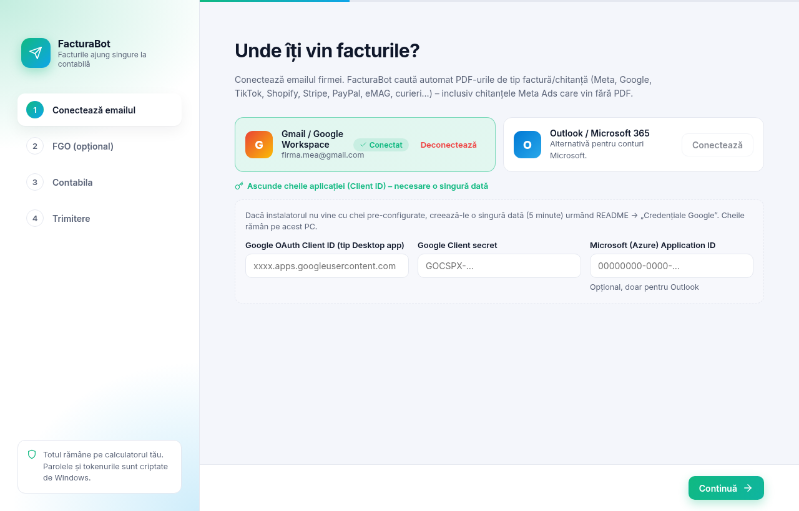
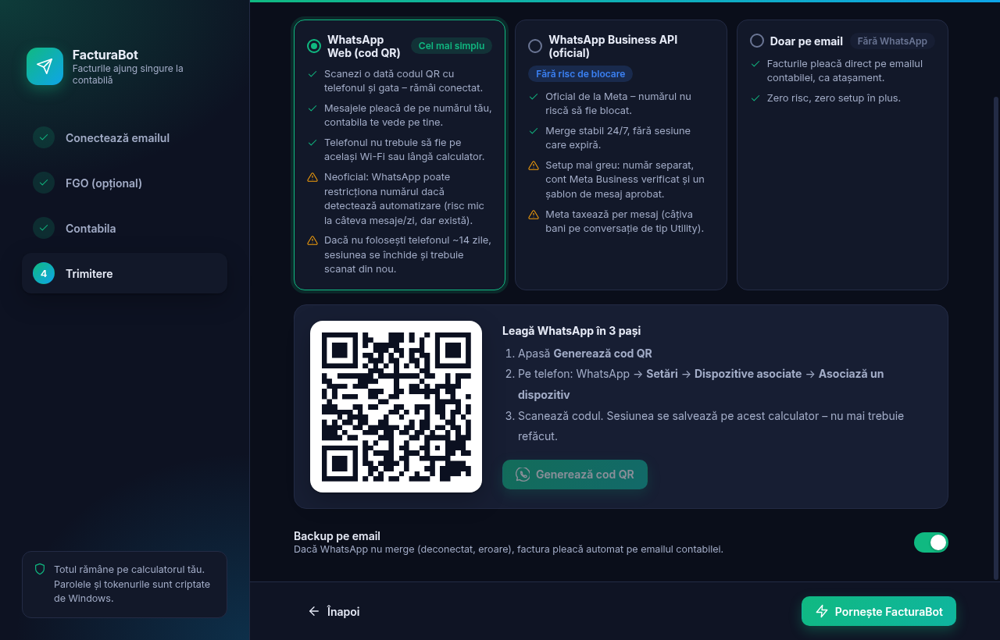
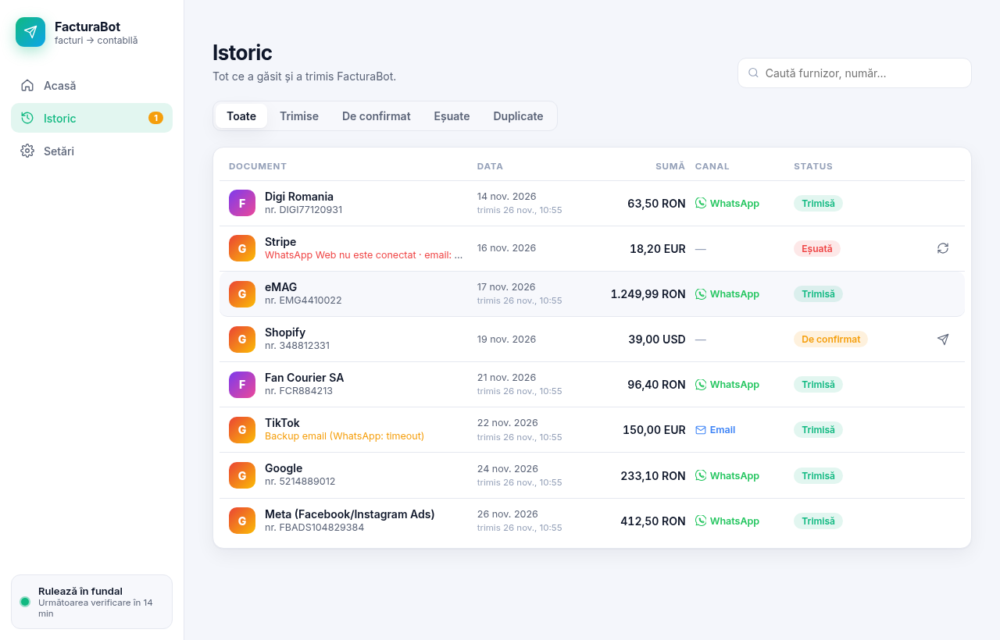
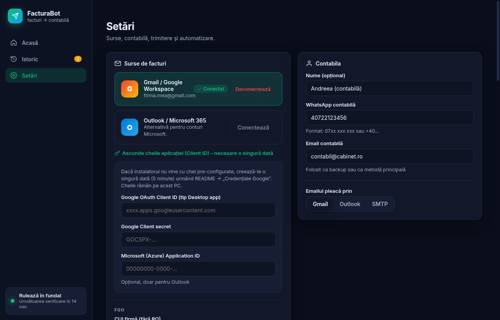

# FacturaBot

**🇷🇴 Facturile ajung singure la contabilă.** FacturaBot este o aplicație Windows care stă discret lângă ceas (în tray), găsește facturile care îți intră pe email (Gmail / Outlook) și în FGO, și le trimite automat contabilei pe **WhatsApp** sau pe **email**.

**🇬🇧 Invoices that deliver themselves to your accountant.** FacturaBot is a Windows tray app that finds incoming invoices in Gmail / Outlook / FGO and forwards them automatically to your accountant via **WhatsApp** or **email**.


| Configurare | WhatsApp prin QR | Istoric | Setări |
|---|---|---|---|
|  |  |  |  |

---

## 🇷🇴 Română

### Ce face
- **Surse:** Gmail / Google Workspace, Outlook / Microsoft 365, FGO (facturi de la furnizori + facturile emise de tine). Detectează PDF-urile cu „factură / invoice / receipt / chitanță” și furnizorii cunoscuți: Meta (Facebook/Instagram Ads), Google, TikTok, Shopify, Stripe, PayPal, eMAG, curieri (Fan Courier, Sameday, Cargus, DPD, GLS), utilități, telecom etc. Chitanțele trimise doar în corpul emailului (Meta, PayPal) sunt transformate automat în PDF.
- **Trimitere**, la alegere:
  1. **WhatsApp Web prin cod QR.** Scanezi o singură dată, iar sesiunea rămâne salvată pe PC. *Neoficial:* WhatsApp poate restricționa numărul dacă detectează automatizare. Riscul e mic la câteva mesaje pe zi, iar FacturaBot face pauze între mesaje, dar riscul există.
  2. **WhatsApp Business Cloud API (oficial, Meta).** Nu există risc de blocare, dar ai nevoie de un număr separat, un cont Meta Business și un șablon aprobat.
  3. **Doar email.**
  
  **Backup:** dacă WhatsApp nu merge (de exemplu s-a deconectat), factura pleacă automat pe emailul contabilei, prin Gmail, Outlook sau SMTP.
- **Fără dubluri:** deduplicare după ID-ul mesajului, conținutul fișierului (SHA-256) și seria/numărul facturii de la același furnizor.
- **Rulează în fundal:** pornește odată cu Windows, verifică la fiecare 15–30 de minute (configurabil), are butonul „Sincronizează acum”, notificări, istoric, opțiunea „Confirm înainte de trimitere” și temă luminoasă sau întunecată.
- **Securitate:** tokenurile și parolele sunt criptate cu Windows DPAPI (`safeStorage`), iar totul rămâne pe calculatorul tău. Nu există niciun server intermediar.

### Instalare (utilizator)
1. Rulează `FacturaBot-Setup-x.y.z.exe`. Instalarea se face pentru utilizatorul curent și nu cere drepturi de administrator.
2. Asistentul are 4 pași: **conectezi emailul**, adaugi FGO (opțional), completezi **datele contabilei** și alegi **cum trimiți**.
3. Gata. Poți închide fereastra, iar aplicația rămâne în tray.

> Dacă instalatorul nu are cheile OAuth incluse, le creezi o singură dată, în aproximativ 5 minute (vezi mai jos), și le lipești în **Setări → Surse → Arată cheile aplicației**.

### Credențiale Google (Gmail)
1. Intră pe <https://console.cloud.google.com/> și creează un proiect, de exemplu „FacturaBot”.
2. Mergi la **APIs & Services → Library**, caută **Gmail API** și apasă **Enable**.
3. În **APIs & Services → OAuth consent screen** (sau **Google Auth Platform**):
   - alege User type **External** (sau **Internal** dacă ai Google Workspace);
   - completează numele aplicației și emailul;
   - la **Data access / Scopes** adaugă `gmail.readonly` și `gmail.send`;
   - la **Audience / Test users** adaugă adresa ta de Gmail.
   - ⚠️ Cât timp aplicația e în modul *Testing*, Google expiră autorizarea după 7 zile. FacturaBot îți arată atunci mesajul „Reconectează Gmail”. Ca să nu mai expire, apasă **Publish app** (aplicațiile pentru uz propriu pot rămâne neverificate) sau folosește un cont Workspace cu tipul *Internal*.
4. Mergi la **Credentials → Create credentials → OAuth client ID** și alege tipul **Desktop app**.
5. Copiază **Client ID** și **Client secret** în FacturaBot (**Setări → Surse de facturi → Arată cheile aplicației**), apoi apasă **Conectează** la Gmail. Se deschide browserul, te loghezi și ai terminat.

### Credențiale Microsoft (Outlook / Microsoft 365)
1. Intră pe <https://entra.microsoft.com/> și deschide **App registrations → New registration**.
2. Completează numele „FacturaBot” și alege la Supported account types **Accounts in any organizational directory and personal Microsoft accounts**.
3. La **Redirect URI** alege platforma **Public client/native (mobile & desktop)** și valoarea `http://localhost`.
4. În **Authentication**, setează **Allow public client flows** pe **Yes**.
5. În **API permissions → Microsoft Graph → Delegated** adaugă `Mail.Read`, `Mail.Send`, `User.Read` și `offline_access`.
6. Copiază **Application (client) ID** în FacturaBot. Pentru Outlook nu ai nevoie de client secret.

### FGO
Cheia API o găsești în FGO la **Setări → Utilizatori → cheie API** (cere-o de la FGO dacă nu apare). Ai nevoie și de CUI-ul firmei, fără „RO”. Documentația API e la <https://api.fgo.ro/docs/>, iar FacturaBot folosește `GET /v2/facturi-furnizori` și `GET /v2/facturi` cu antetele `Authorization: Bearer` și `Fgo-Cod-Unic`.

### WhatsApp Business Cloud API (varianta oficială)
1. Intră pe <https://developers.facebook.com/>, creează o aplicație de tip **Business** și adaugă produsul **WhatsApp**.
2. Adaugă și verifică un **număr de telefon separat**. Copiază **Phone number ID**.
3. Creează un **System User** în Business Settings și generează un **token permanent** cu permisiunile `whatsapp_business_messaging` și `whatsapp_business_management`.
4. Creează un **șablon de mesaj** cu următoarele setări și așteaptă aprobarea:
   - categoria **Utility**;
   - numele `factura_noua`;
   - limba `ro`;
   - **Header: Document**;
   - **Body:** `Bună ziua! Vă trimit o factură nouă: {{1}}.`
5. Completează datele în **Setări → Trimitere pe WhatsApp → WhatsApp Business API** și apasă **Trimite un test**.

### Setări avansate (toate opțiunile se pot configura)
| Setare | Implicit | Unde |
|---|---|---|
| Interval verificare | 20 min (5–240) | Setări → Automatizare / `FACTURABOT_POLL_MINUTES` |
| Zile căutate la prima sincronizare | 30 | Setări → Automatizare / `FACTURABOT_LOOKBACK_DAYS` |
| Furnizori proprii, expeditori ignorați, cuvinte cheie extra | – | Setări → Avansat |
| Sensibilitate detectare (scor minim) | 3 | Setări → Avansat |
| Mărime maximă atașament | 25 MB | Setări → Avansat |
| Încercări de trimitere / fereastră de reîncercare | 5 / 7 zile | Setări → Avansat |
| Pauză între mesaje WhatsApp | 4 s | Setări → Avansat |
| Filtru Gmail suplimentar | – | Setări → Avansat |
| URL API FGO | `https://api.fgo.ro` | `FACTURABOT_FGO_API_BASE` |
| Versiune Graph API WhatsApp | `v21.0` | `FACTURABOT_WA_API_VERSION` |
| Folder date | `%APPDATA%\FacturaBot` | `FACTURABOT_DATA_DIR` |
| Client ID-uri OAuth | – | Setări sau la build: `FACTURABOT_GOOGLE_CLIENT_ID`, `FACTURABOT_GOOGLE_CLIENT_SECRET`, `FACTURABOT_MS_CLIENT_ID` |

Toate valorile sunt validate la salvare. Numerele în afara limitelor sunt aduse în interval, iar valorile necunoscute revin la cele implicite. Problemele de configurare, cum ar fi un email al contabilei invalid, apar pe pagina „Acasă”.

### Unde sunt datele
`%APPDATA%\FacturaBot\` conține:
- `settings.json`;
- `secrets.bin.json` (criptat DPAPI);
- `facturabot.sqlite` (istoric și deduplicare);
- `wa-session\` (sesiunea WhatsApp Web);
- `facturi\AAAA-LL\` (copiile PDF).

---

## 🇬🇧 English

### Features
- **Sources:** Gmail, Outlook / Microsoft 365 (Graph) and FGO API v2 (supplier invoices and issued invoices). Sources use a plugin registry (`src/main/sources/registry.ts`), so ANAF e-Factura or ads billing APIs can be added later.
- **Delivery:** WhatsApp Web via QR (Baileys multi-device, session persisted locally), the official WhatsApp Cloud API (approved Utility template with a document header) or email only. If WhatsApp fails, the invoice falls back to email (Gmail API, Graph `sendMail` or SMTP).
- **Reliability:**
  - deduplication by message ID, SHA-256 and series number per vendor;
  - a serialized send queue, so nothing is sent twice;
  - retries with exponential backoff and `Retry-After` handling;
  - a configurable retry budget;
  - invoices interrupted mid-send are re-queued after a crash;
  - OAuth refresh is single-flight, and an `invalid_grant` response leads to a "reconnect" notification;
  - Baileys close-code handling: 515 → reconnect, 401 → new QR, 440/403 → stop, an unscanned QR → stop, and backoff is capped.
- **Desktop:** tray icon, autostart on login (`--hidden`), notifications, an app menu with shortcuts (Ctrl+R sync, Ctrl+1/2/3 to navigate), dark/light/system theme and a Romanian UI.

### Setup
The user only signs in. The app's OAuth clients need to be created once: by the person who builds the installer (baked in through CI secrets) or by the user in Settings.
- **Google:** Cloud Console → enable the Gmail API → OAuth consent screen with the scopes `gmail.readonly` and `gmail.send` → create an OAuth client of type **Desktop app**. Paste the Client ID and secret into Settings, or bake them in at build time. While the app is in *Testing* mode, refresh tokens expire after 7 days; publish the app to avoid this.
- **Microsoft:** Entra ID → App registration (multi-tenant + personal accounts):
  - redirect `http://localhost` with the **Public client/native** platform;
  - *Allow public client flows* = Yes;
  - delegated Graph permissions `Mail.Read`, `Mail.Send`, `User.Read` and `offline_access`.
- **WhatsApp Cloud API:** Meta app → WhatsApp → phone number ID, a permanent System User token, and an approved template (`factura_noua`, Utility, document header, body `{{1}}`).

### Development
```bash
npm install
npm run dev            # Vite + Electron with hot reload
npm run lint           # ESLint (typescript-eslint, react-hooks)
npm run typecheck      # tsc --noEmit
npm test               # Vitest: unit + integration tests with mocked Gmail/Graph/FGO/WhatsApp/SMTP
npm run test:coverage  # + v8 coverage (thresholds: 70% lines/functions, 60% branches)
npm run check          # all of the above
FACTURABOT_DEMO=1 npx electron .   # demo mode: fake data, touches no real accounts
```
To take screenshots, run `FACTURABOT_DEMO=1 FACTURABOT_SCREENSHOT_DIR=screenshots xvfb-run -a npx electron . --no-sandbox`. Add `FACTURABOT_DEMO_QR=1` to show a QR code (fake, offline).

### Building the Windows installer
- **Locally on Windows:** run `npm run dist:win`. The installer is written to `release/FacturaBot-Setup-<version>.exe`.
- **On Linux:** the same command works when `wine` is installed. This is how the installer in this repo was built.
- **CI:** `.github/workflows/build.yml` runs on `windows-latest` for `v*` tags or a manual dispatch, and uploads the NSIS `.exe` as an artifact. Set the `FACTURABOT_GOOGLE_CLIENT_ID`, `FACTURABOT_GOOGLE_CLIENT_SECRET` and `FACTURABOT_MS_CLIENT_ID` repo secrets to ship a zero-setup build. `.github/workflows/ci.yml` runs lint, type-check, tests with coverage and the build on Ubuntu and Windows for every push and PR.

The installer isn't code-signed, so Windows SmartScreen shows "More info → Run anyway" on first launch. To avoid it, add a code-signing certificate (`CSC_LINK` / `CSC_KEY_PASSWORD`).

### Project layout
```
src/main/            Electron main: tray, IPC, sync engine, SQLite (sql.js), secrets (safeStorage)
  sources/           gmail.ts, outlook.ts, fgo.ts, classify.ts, registry.ts  ← add new sources here
  delivery/          whatsappWeb.ts (Baileys), whatsappCloud.ts, email.ts, dispatcher.ts (fallback logic)
  oauth/             loopback PKCE flow for Google & Microsoft
  http.ts            fetchWithRetry (429/5xx/network, Retry-After)
src/renderer/        React UI (Onboarding, Dashboard, History, Settings)
tests/               Vitest suites (mocks for every external API)
```

### Known limitations
- WhatsApp Web automation is unofficial. WhatsApp may restrict numbers that send automated messages, so use the Cloud API for zero risk.
- The FGO API doesn't return a PDF for supplier invoices, so FacturaBot sends a text summary. Issued invoices are sent as PDFs.
- ANAF e-Factura (SPV) needs a qualified certificate and isn't included yet. The source registry is ready for it.

License: MIT
